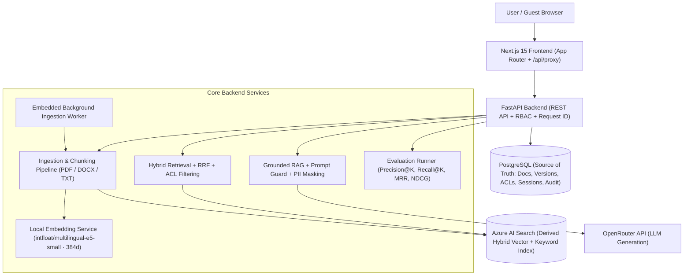

# Enterprise AI Intelligence Platform

A production-oriented, security-first **Enterprise Knowledge Intelligence & Retrieval-Augmented Generation (RAG)** platform. It enables organizations to ingest, version, search, and converse with internal documents using **Hybrid Search (Azure AI Search)**, **Local Embeddings (`intfloat/multilingual-e5-small`)**, **OpenRouter LLMs**, **PostgreSQL (SQLAlchemy 2.x + Alembic)**, and **Next.js**.

---

## Architecture Overview



### Key Architectural Principles
- **PostgreSQL as Source of Truth**: Owns document identities, version lifecycle (`uploaded -> processing -> indexing -> ready -> published -> superseded`), chunk metadata, users, roles, document-level ACLs (`DocumentPermission`), chat sessions, review tasks, evaluation runs, and audit logs.
- **Azure AI Search as Derived Index**: Stores searchable text and 384-dimensional `intfloat/multilingual-e5-small` vectors (`passage: ` / `query: ` prefixes).
- **Strict Authorization Before Retrieval**: Every search and chat request resolves authorized document versions in PostgreSQL before querying Azure AI Search or sending context to OpenRouter. The LLM never acts as an authorization boundary.
- **Grounded Generation & Governance**: Includes prompt-injection protection, PII masking, citation verification, abstention on insufficient evidence, human review escalation, and structured JSON audit logging.

---

## Tech Stack

| Layer | Technology |
| :--- | :--- |
| **Frontend** | Next.js 15, React, TypeScript, Tailwind CSS, Lucide Icons |
| **Backend** | Python 3.12, FastAPI, Pydantic v2, SQLAlchemy 2.x, Alembic, Psycopg 3 |
| **Dependency Manager** | Astral `uv` (`pyproject.toml` + `uv.lock`) |
| **Database** | PostgreSQL 16 (Local Docker / Neon Serverless in Production) |
| **Search Engine** | Azure AI Search (Keyword + Vector + Hybrid + RRF) |
| **Embeddings** | `intfloat/multilingual-e5-small` (384 dimensions, local CPU/ONNX inference) |
| **LLM Provider** | OpenRouter (`baidu/ernie-5.5-flash-preview:free`, fallback `nvidia/nemotron-3-ultra-550b-a55b:free`) + `MockLLMProvider` for tests |
| **Cloud & CI/CD** | Azure Container Apps (`minReplicas: 0`), Azure Container Registry, Bicep, GitHub Actions |

---

## Project Structure

```text
enterprise-ai-intelligence-platform/
├── .github/workflows/ci.yml        # CI tests (backend + frontend) & Azure CD pipeline
├── backend/
│   ├── alembic/                    # Database schema migrations
│   ├── app/
│   │   ├── api/v1/routes/          # auth, chat, documets, search, evaluations, reviews, governance, health
│   │   ├── core/                   # config (Pydantic Settings), security (JWT/RBAC), logging, request_context
│   │   ├── database/               # SQLAlchemy 2.x models & session management
│   │   ├── providers/llm/          # LLMProvider abstraction (OpenRouterProvider, MockLLMProvider)
│   │   ├── schemas/                # Pydantic request/response schemas
│   │   ├── services/
│   │   │   ├── ingestion/          # Validation, SHA-256 dedup, PDF/DOCX/TXT extractors, structure-aware chunking, embeddings
│   │   │   ├── search/             # Azure AI Search index schema, vector indexing, hybrid retrieval & RRF
│   │   │   ├── generation/         # Grounded RAG service & prompt-injection guard
│   │   │   ├── governance/         # RBAC + document ACLs, PII masking, audit logging, human reviews
│   │   │   └── evaluation/         # Retrieval & RAG evaluation runner + metrics
│   │   └── workers/                # Background ingestion worker
│   ├── tests/                      # Pytest suite (119 tests)
│   ├── Dockerfile.backend
│   ├── pyproject.toml
│   └── uv.lock
├── frontend/
│   ├── src/
│   │   ├── app/
│   │   │   ├── api/proxy/[...path]/route.ts  # Server-side proxy to FastAPI backend
│   │   │   └── page.tsx                      # Chat, Knowledge Base, Search, Evaluations & Governance UI
│   │   ├── components/
│   │   ├── lib/api.ts
│   │   └── types/api.ts
│   └── Dockerfile
└── infra/
    ├── azure/
    │   ├── container-apps.bicep    # Scale-to-zero Azure Container Apps & Managed Environment
    │   └── deploy.ps1              # One-command Azure deployment script
    └── docker-compose.yml          # Local PostgreSQL service
```

---

## Core API Endpoints (`/api/v1`)

- **Health**: `GET /api/v1/health`, `/api/v1/health/database`, `/api/v1/health/azure-search`, `/api/v1/health/llm`
- **Auth**: `POST /api/v1/auth/login`, `POST /api/v1/auth/guest` (30-min read-only `Public` demo token), `GET /api/v1/auth/me`
- **Documents**: `POST /api/v1/documents` (upload), `GET /api/v1/documents` (ACL-filtered list), `GET /api/v1/documents/{version_id}` (status)
- **Search & Chat**: `POST /api/v1/search`, `POST /api/v1/chat`, `GET /api/v1/chat/sessions`, `GET /api/v1/chat/sessions/{session_id}`, `DELETE /api/v1/chat/sessions/{session_id}`
- **Evaluations & Governance**: `POST /api/v1/evaluations/run`, `GET /api/v1/evaluations`, `POST /api/v1/reviews`, `GET /api/v1/reviews`, `POST /api/v1/reviews/{review_id}/resolve`, `GET /api/v1/audit-logs`

---

## Local Development Setup

### Prerequisites
- Python 3.12+ & [Astral `uv`](https://docs.astral.sh/uv/)
- Node.js 20+ & `npm`
- PostgreSQL 16 (local Docker or Neon)

### 1. Backend
```powershell
cd backend
cp .env.example .env   # Fill in DATABASE_URL, AZURE_SEARCH_*, OPENROUTER_API_KEY, AUTH_SECRET_KEY
uv sync --locked
uv run alembic upgrade head
uv run uvicorn app.main:app --reload --port 8000
```

Run tests:
```powershell
cd backend
uv run python -m pytest -q
```

### 2. Frontend
```powershell
cd frontend
cp .env.example .env.local   # BACKEND_INTERNAL_URL=http://127.0.0.1:8000
npm install
npm run dev
```
Open `http://localhost:3000`.

---

## Azure Deployment & Monthly Cost Optimization

This project is engineered to run comfortably on **Azure for Students (\$100 credit)** using scale-to-zero and free-tier services:

| Resource | Tier / Configuration | Estimated Monthly Cost |
| :--- | :--- | :--- |
| **Azure Container Apps** (Backend + Frontend) | Consumption plan, `minReplicas: 0`, `maxReplicas: 3` | **\$0** (within 180k vCPU-s, 360k GiB-s, 2M requests/mo free grant) |
| **Azure Container Registry (ACR)** | `Basic` SKU | **~\$5.00 / month** |
| **Azure AI Search** | `Free` tier (50 MB, 3 indexes) | **\$0** |
| **Log Analytics Workspace** | Per-GB (5 GB/mo free allowance) | **\$0** |
| **PostgreSQL** | Neon Serverless Free Tier | **\$0** |
| **LLM Inference** | OpenRouter `:free` models | **\$0** |
| **Total Estimated Cost** | | **~\$5 / month** |

> **Cost Tip**: Keep Azure AI Search on the **Free** tier (upgrading to Search `Basic` adds ~\$75/month). To eliminate the ~\$5/month ACR cost as well, images can be pushed to GitHub Container Registry (`ghcr.io`) instead of ACR.

---

## CI/CD (GitHub Actions)

Workflow: [`.github/workflows/ci.yml`](.github/workflows/ci.yml)
1. **`backend-tests`**: Runs `uv run alembic upgrade head` + `pytest` against a `postgres:16` service container.
2. **`frontend-build`**: Runs `npm install` + `npm run build`.
3. **`deploy-azure`** (runs on push to `main` when `vars.AZURE_DEPLOY_ENABLED == 'true'`):
   - Logs into Azure (`secrets.AZURE_CREDENTIALS`)
   - Builds and pushes backend & frontend images to ACR
   - Runs `uv run alembic upgrade head` against `secrets.PROD_DATABASE_URL`
   - Updates `enterprise-ai-backend` and `enterprise-ai-frontend` in Azure Container Apps

### Required GitHub Configuration
- **Repository Secrets**:
  - `AZURE_CREDENTIALS`: Service principal JSON from `az ad sp create-for-rbac --sdk-auth`
  - `PROD_DATABASE_URL`: Production PostgreSQL URL (e.g., Neon `postgresql://...` — normalized automatically to `postgresql+psycopg://`)
- **Repository Variables**:
  - `AZURE_DEPLOY_ENABLED`: `true`
